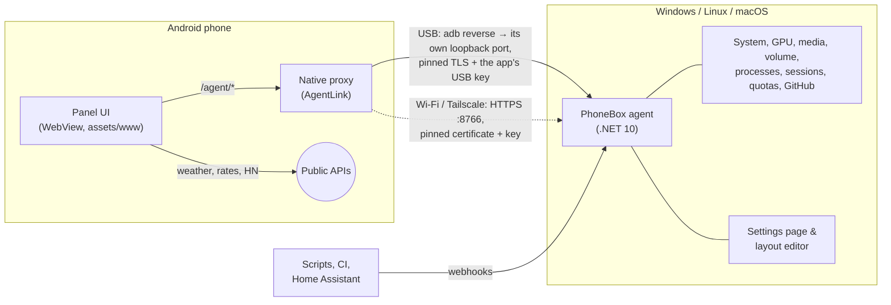

# Development guide

[Back to PhoneBox](../README.md) · [Installation and connections](SETUP.md) · [User guide](GUIDE.md)

[How it works](#how-it-works) · [Development](#development)

## How it works



- The WebView never talks to the PC directly: requests to `/agent/*` are intercepted by the app and forwarded over
  the adb tunnel (or the pinned HTTPS connection), so there are no CORS, mixed-content or local-network issues.
- Live events (page switches, notifications, permission prompts) arrive over one server-sent-events stream
  (`/api/stream`); plain polling remains as the fallback.
- The agent samples only what is on screen: process lists and command widgets run only while a phone looks at them.

## Development

Contributions are welcome: read [CONTRIBUTING.md](../CONTRIBUTING.md) first (scope, the security model, privacy and tests).

Use the .NET 10 SDK for the agent, JDK 17 and Android SDK Platform 35 for Android builds, and Python 3 plus
Node.js 22 for the browser tooling. The Gradle wrapper downloads Gradle automatically.

Run the following commands from the repository root unless a working directory is shown.

### Local preview

```sh
python tools/demo-server.py
```

The server stays running in this terminal. Open <http://127.0.0.1:8790/panel/> or
<http://127.0.0.1:8790/settings/>. Use a second terminal for other commands.

### Checks

```sh
python tools/check-release.py
dotnet test agent/PhoneBox.Agent.Tests
```

Browser tests need Node.js 22 and Chromium:

```sh
cd tools/ui-tests
npm ci
npx playwright install chromium
npx playwright test
```

On Linux CI, use `npx playwright install --with-deps chromium`. Playwright starts its own demo on port 8781.

### Build and run

On Windows, from the repository root:

```powershell
.\scripts\build.ps1 # release APK + five agent archives in dist/
```

To build only the Android app with API compatibility lint:

```powershell
cd android
.\gradlew.bat lintDebug assembleDebug
```

Run the Windows agent from the repository root:

```powershell
dotnet run --project agent/PhoneBox.Agent -f net10.0-windows10.0.19041.0
```


On Linux or macOS, run the agent with `dotnet run --project agent/PhoneBox.Agent -f net10.0` and build the APK
with `cd android && ./gradlew assembleDebug`. On Windows, the explicit `-f` selects one of the project's two
target frameworks. Set `ANDROID_HOME` or `android/local.properties` (`sdk.dir`) to the Android SDK location.

### Demo data and media

The demo server needs only Python. It serves the same demo as the [live one](https://ersinkoc.github.io/phonebox/)
(made-up data in [`tools/pages/demo.js`](../tools/pages/demo.js)) straight from the sources, so a reload shows your
changes. Size the browser window to 780 × 360 (the phone's screen in CSS pixels) and the panel behaves as on the
phone, including webhooks: `curl -X POST http://127.0.0.1:8790/api/notify -d hello` (also `/api/push/<key>`,
`/api/goto/<page>` and `/api/ask` for a made-up permission prompt).

With the demo server running, generate media from a second terminal:

```sh
cd tools/ui-tests
node media.js shots home system
node media.js tour
node media.js hero
```

Install the browser tooling above first. The tour also needs FFmpeg. Run `pwsh tools/make-icon.ps1` from the
repository root to regenerate the application icon.

### Source layout

The panel is plain ES modules: [`main.js`](../android/app/src/main/assets/www/main.js) (core, pages, navigation, data
from the agent) and the widgets in [`widgets/`](../android/app/src/main/assets/www/widgets). A widget is a
`{ needs, create(box, ctx) → { update(kind) } }` entry in the `W` registry, plus its styles in `style.css` and its catalogue entry
(name, size, options) in [`widgets.json`](../agent/PhoneBox.Agent/widgets.json), which drives the settings editor.
Templates live in [`templates.json`](../agent/PhoneBox.Agent/templates.json).

### Isolated agent runs

To check a development agent beside an installed one, run it with an isolated settings file and port, for example
`PhoneBoxAgent.exe --config "D:\test folder\config.json" --port 18765`. Settings and browser checks use
`http://127.0.0.1:18765/`; restarts preserve these arguments. The ordinary port remains 8765. Set `deviceSerial`
explicitly in the test settings (an unmatched serial disables USB attachment) and turn off automatic updates.
USB clients still use phone port 8765; do not assign the same phone to two agents at once.

### Release signing

Release APKs are signed with your own key when `PHONEBOX_STORE_FILE`, `PHONEBOX_STORE_PASSWORD`, `PHONEBOX_KEY_ALIAS`
and `PHONEBOX_KEY_PASSWORD` are set (in `~/.gradle/gradle.properties` or the environment); otherwise the debug key
is used. Debug builds make the WebView debuggable through `chrome://inspect`. To publish a release: bump the
version in `PhoneBox.Agent.csproj` and `android/app/build.gradle.kts`, commit, then run `.\scripts\release.ps1`.
The script dispatches the gated GitHub release workflow; see [the release checklist](RELEASING.md).

## Translations

The Android panel and desktop editor load the same `assets/www/i18n.js` and
`locale-*.js` dictionaries. Use `t()` for interface keys, `tc()` for widget,
template, and editor captions, and `tp()` for panel labels indexed by their
English text. Preserve placeholders, HTML tags, paths, and protocol identifiers.
Widget positions are measured from the left in both left-to-right and right-to-left interfaces.

Each locale also has Android pairing strings in `res/values-*/strings.xml`, a
Windows `TrayStrings.<culture>.resx`, and a localized README. After adding a
language to `i18n.js`, run `python tools/sync-locales.py` to update the two
platform lists and the README links. Add the locale's dictionary to the panel
and editor script lists. Run `python tools/check-release.py` and the Playwright
localization tests after changing a locale.
