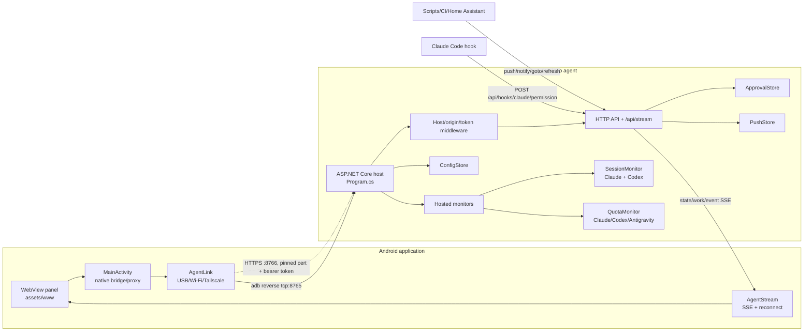

# System architecture

## Component diagram



## Desktop lifecycle

`Program.cs` selects a port, enforces one instance, loads and persists generated config tokens, binds loopback and optional LAN HTTPS, registers monitors as hosted services, then maps routes. The local listener is loopback-only by default. `SessionMonitor` samples every two seconds; quota and other monitors have their own schedules and can be woken by `/api/refresh`.

The agent exposes a public projection of configuration through `/api/config`; secrets, shortcut commands, feed URLs, and integration tokens are intentionally retained on the PC. The panel receives state snapshots and work/quotas through the API rather than direct filesystem access.

## Android lifecycle and transport

`AgentLink` attempts USB loopback first, then each paired Wi-Fi/Tailscale address. USB is only reachable because `AdbReverse` installs `tcp:8765` reverse forwarding. Wi-Fi uses the stored certificate fingerprint as identity and bearer token as authorization. `AgentStream` keeps one `/api/stream` connection and falls back to panel polling when it is unavailable.

The WebView receives `/agent/*` requests through the native proxy, preventing arbitrary widget frames from directly accessing the agent. `MainActivity` also supplies a bridge key to restrict native calls to panel-owned frames.

## Data flow

```mermaid
sequenceDiagram
  participant Provider as AI provider/local files
  participant Agent as Desktop agent
  participant Store as Config/Approval/Push stores
  participant Link as Android AgentLink
  participant UI as WebView panel
  Provider->>Agent: session files, rollout files, quota RPC/CLI, or Claude hook
  Agent->>Store: normalize snapshots / pending approval / event
  Link->>Agent: GET /api/state or /api/stream
  Agent-->>Link: state, work, event SSE
  Link-->>UI: proxied JSON/events
  UI->>Link: POST control or approval decision
  Link->>Agent: authenticated request
  Agent->>Store: decide/act
  Agent-->>Provider: Claude hook JSON decision (Claude only)
```

