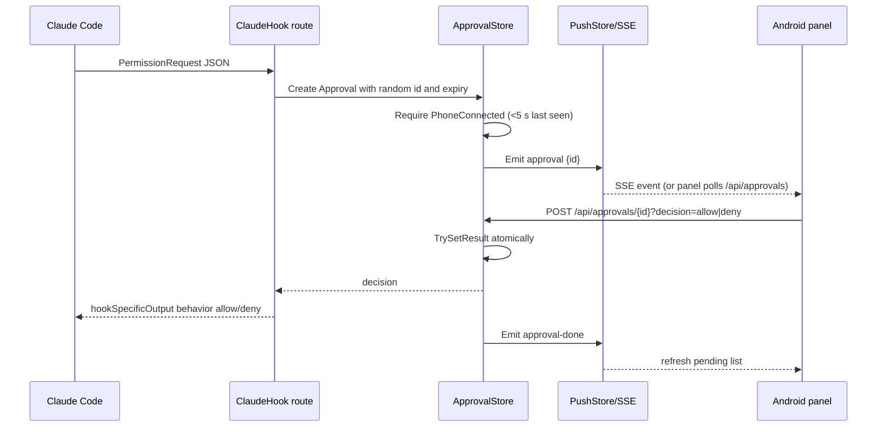

# Approval lifecycle

## Normal flow

## Request origin and representation

The only verified origin is Claude's `PermissionRequest` command hook, installed by [`ClaudeHook.Configure`](../../agent/PhoneBox.Agent/ClaudeHook.cs). `Approval` contains `Id`, `Source`, `Session`, `Project`, `Tool`, `Detail`, optional `Description`, creation/expiry timestamps, and `Kind` (`permission` or `question`). `AskUserQuestion` is deliberately not answered by Allow/Deny; the panel sends `skip` so the terminal remains authoritative.

## Store and concurrency

`ApprovalStore` uses `ConcurrentDictionary<string, Pending>`. IDs are six random bytes encoded as lowercase hex. `Decide` accepts only `allow`, `deny`, or `skip` and uses `TaskCompletionSource.TrySetResult`, so concurrent decisions resolve once. `AskAsync` removes the entry in `finally` and emits `approval-done`.

The implementation does not reject a duplicate ID before assignment: a provider reusing an existing ID would replace the pending entry. The current Claude caller generates a fresh ID, but a future adapter must preserve uniqueness across concurrent providers.

## Timeout, cancellation, and disconnect

- If no phone was seen in the last five seconds, `AskAsync` returns null and Claude falls back to its terminal prompt.
- The timeout is derived from `ExpiresAt`, clamped to at least one second; cancellation of the hook request returns null.
- A phone disconnect stops future phone eligibility but does not automatically cancel an already pending request. It ends on decision, expiry, or hook cancellation.
- `/api/stream` event history is only 50 events and one minute old. A Wi-Fi reconnect can miss the `approval` event; the panel therefore polls `/api/approvals` every five seconds while visible.
- Agent restart destroys the in-memory dictionary and event queue. There is no recovery or durable cancellation signal to the originating hook.

## Phone decision path

`main.js` filters locally answered IDs, prevents duplicate submissions per ID, disables buttons during POST, and retains the card if the POST fails. A successful response removes the card. Expired cards are removed after three seconds past expiry. The route returns `404` for unknown/stale IDs.

## Required invariants for future providers

1. Generate a globally unique, unguessable request ID and preserve provider/session correlation.
2. Do not map an external prompt into `Approval` until its authenticity and decision semantics are known.
3. Use the existing event plus polling contract; do not create a second phone transport.
4. Define provider behavior for expiry, cancellation, phone loss, desktop restart, and duplicate decisions.
5. Add route-level tests and a provider-to-decision integration test before enabling UI controls.

